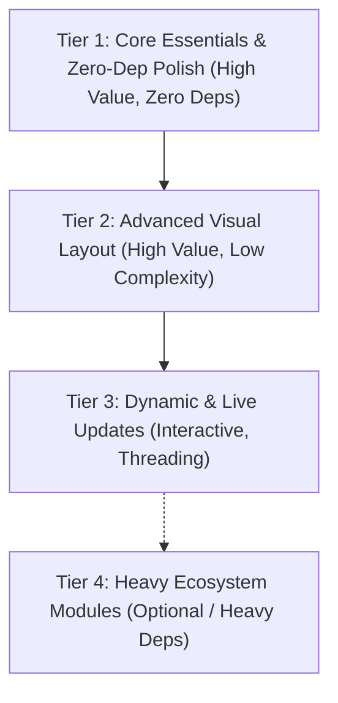

# C++ Rich Library Pragmatic Roadmap

This document structures the roadmap for **Rich C++** by **complexity vs. value tiers**, enabling modular development without forcing heavy third-party dependencies unless explicitly desired.

---

## Current Status Overview

| Tier | Focus | Dependencies | Status |
| :--- | :--- | :--- | :---: |
| **Tier 0** | Architectural Kernel & Basic Widgets | 0 (Pure C++20) | ✅ **Completed & Validated** |
| **Tier 1** | Core Polish & Text Foundations (Boxes, Wrapping, Terminal Width, NO_COLOR) | 0 (Pure C++20) | ✅ **Completed & Validated (16/16 Oracle)** |
| **Tier 2** | Advanced Visual Layout (Tree, Align, Constrain, Layout) | 0 (Pure C++20) | ✅ **Completed & Validated (16/16 Oracle)** |
| **Tier 3** | Dynamic & Live Displays (Progress Bars, Spinners) | 0 (`std::jthread` / VT escapes) | ✅ **Completed & Validated (20/20 Oracle)** |
| **Tier 4** | Heavy Ecosystem Modules (JSON, Syntax, Markdown, HTML/SVG Export, Traceback) | 0 (Pure C++20 + Win32/DbgHelp) | ✅ **Completed & Validated (33/33 Oracle)** |

---

## Tier 0: Architectural Kernel & Proof-of-Concept *(Completed)*
- [x] **Renderable Concept & AnyRenderable**: C++20 ADL customization points (`render_item`, `measure_item`) with value-semantic type erasure.
- [x] **Core Primitives**: `Segment`, `Style` (16 ANSI colors, bright variants, bold, dim, italic, underline, reverse, RGB), `Color`.
- [x] **Console**: `Console::print`, `Console::rule`, `Console::export_text`, record mode buffer, automatic Windows `CP_UTF8` and VT processing initialization.
- [x] **Containers & Decorators**:
  - `Panel` with centered title, custom borders, multiline support.
  - `Table` with multi-column grid, Unicode box drawing, column justification.
  - `Columns` with multi-row wrapping and independent left-aligned lines.
  - `Padding` with pipe operator (`|`) composition.
- [x] **Initial Oracle Validation**: Exact byte-level matches for basic Panel, Table, Rule, and Columns layouts.

---

## Tier 1: Core Essentials & Zero-Dep Polish *(Completed)*
*Goal: Make the library completely robust for standard CLI tool output with zero external dependencies.*

### 1.1 Terminal Dimensions & Stream Detection
- [x] **Auto Terminal Width**:
  - Windows: Query `GetConsoleScreenBufferInfo` for active window column count.
  - POSIX: Query `ioctl(STDOUT_FILENO, TIOCGWINSZ, &ws)`.
  - Fallback: Defaults to 80 columns when redirected or in fixed mode.
- [x] **NO_COLOR Standard**:
  - Respects `NO_COLOR` environment variable (https://no-color.org).

### 1.2 Text Wrapping & Formatting (`rich::text::Text`)
- [x] **Word Wrapping Engine**:
  - Soft-wrap text streams at whitespace boundaries to fit within console width.
  - Exact whitespace and trailing newline parity with Python Rich text wrapping.

### 1.3 Box Style Library (`rich::box`)
- [x] **Box Presets (`src/rich-cpp/core/box.h`)**:
  - `box::ROUNDED` (`╭─╮│╰─╯`)
  - `box::SQUARE` (`┌─┐│└─┘`)
  - `box::HEAVY` (`┏━┓┃┗━┛`)
  - `box::DOUBLE` (`╔═╗║╚═╝`)
  - `box::ASCII` (`+-+|+-+`)
- [x] **Configurable Borders**: Both `Panel` and `Table` accept arbitrary box styles via designated initializers.

### 1.4 Oracle Parity Validation
- [x] Automated byte-level validation for `box_double`, `box_heavy`, `box_ascii`, and `text_wrap` (all passing).

---

## Tier 2: Advanced Visual Layout *(Completed - Zero Dependencies)*
*Goal: Deliver full visual dashboard and structural composition capabilities.*

### 2.1 `Tree` Widget (`rich::tree::Tree`)
- [x] **Hierarchical Data Visualization (`src/rich-cpp/panel/Tree.h`)**:
  - Nested tree branches with guide glyphs (`├── `, `└── `, `│   `).
  - Arbitrary labels with inline markup parsing.
  - Verified bit-for-bit against Python Rich `Tree` (Oracle test `tree_basic`).

### 2.2 `Align` & `Constrain` Decorators
- [x] **`Align` (`src/rich-cpp/panel/Align.h`)**: Wrapper to horizontally center, left-align, or right-align any renderable within console width.
  - Syntax: `panel(...) | align(Justify::Center)`
  - Line normalization + padding parity with Python `Align` (Oracle tests `align_center`, `align_right`, `align_left`).
- [x] **`Constrain` (`src/rich-cpp/panel/Constrain.h`)**: Clamp maximum width of any nested renderable.
  - Syntax: `table | constrain(60)`
  - Verified bit-for-bit against Python `Constrain` (Oracle test `constrain_basic`).

### 2.3 `Layout` Engine (Flexible Grid Splits)
- [x] Split screen into sub-regions:
  - `layout.split_row(...)` (horizontal division).
  - `layout.split_column(...)` (vertical division).
  - Proportional sizing via `ratio` (e.g. 1:2 split).
  - Fixed-size constraints (`size = 10`).
- [x] **`Layout` (`src/rich-cpp/panel/Layout.h`)**: recursive region division via `split_row` / `split_column`, fixed `size` + proportional `ratio` distribution (Python `ratio_resolve` parity), named sub-layout lookup (`get("name")`). Verified bit-for-bit against Python Rich (Oracle tests `layout_row`, `layout_column`).

---

## Tier 3: Dynamic & Live Displays *(Completed - Self-Contained)*
*Goal: Support in-place terminal redraws, progress bars, and status spinners.*

### 3.1 Smooth Progress Bar (`rich::progress`)
- [x] **Block Progress Bar (`src/rich-cpp/core/ProgressBar.h`)**:
  - Fraction block characters: `█` (filled, bold green) and `░` (empty, dim).
  - Percentage indicator with aligned padding (bold cyan).
  - Oracle test: `progress_bar_basic` (0/25/50/75/100%, byte-exact).
- [x] **Multi-Column Progress Tracker (`src/rich-cpp/core/ProgressTracker.h`)**:
  - Half-cell bar rendering (`━`×N + optional `╸`) matching Python Rich's `ProgressBar` exactly.
  - Rolling-window speed estimation (30 s window, deque of `(timestamp, delta)` samples).
  - ETA estimator: `ceil(remaining / speed)` formatted as `H:MM:SS`; `-:--:--` when unknown.
  - Table.grid column-width algorithm for multi-task layout (bar preferred width 40, shrink-wrap).
  - Oracle tests: `progress_tracker` (frozen clock), `progress_speed` (advancing clock, speed 8.4 it/s, ETA `0:00:02`).
- [x] **Range Tracking Adapter (`src/rich-cpp/core/Track.h`)**:
  - `track(tracker, "desc")(range)` returns a `TrackRange` that ticks the task on each iteration.
  - Usage: `for (auto& x : track(tracker, "Processing")(items)) { ... }`
  - Verified: 100% / `0:00:00` on full loop; exception-safe mid-loop at 60%.

### 3.2 Live Display Engine (`rich::live`)
- [x] In-place screen redraw using VT cursor repositioning escapes (`\x1b[<N>F` move up, `\r\x1b[2K` erase per line).
- [x] Atomic screen flush via mutex to prevent output tearing.
- [x] Background refresh loop driven by `std::jthread`; deterministic teardown (join before state clear).
- [x] Non-TTY degradation: single plain final render, no control codes, no thread (matches Python behavior).
- [x] Transient mode: erases the live region on stop.
- [x] Oracle test: `live_static` (static render path, byte-exact).

### 3.3 Status Spinner (`rich::status`)
- [x] Indeterminate loading spinners using animated Braille frames (`⠋⠙⠹⠸⠼⠴⠦⠧⠇⠏`).
- [x] Background `std::jthread` rewrites the line in place every 80 ms (`\r\x1b[2K` + new frame).
- [x] Deterministic teardown: `stop()` joins the worker before clearing console pointer (fixes use-after-free crash when followed by a `Live`).
- [x] Static render path (frame 0) for oracle comparison: `status_static` test passes.

---

## ✅ Tier 4: Heavy Ecosystem Modules *(Completed - Zero Dependencies)*
*Goal: Provide specialized document rendering or introspection.*
*All modules implemented with zero third-party C++ dependencies; `md4c`/`cpptrace` were never required.*

### 4.5 SVG Export (`rich::Console::export_svg`) *(Completed - Zero Dependencies)*
- [x] **Terminal snapshot as SVG (`src/rich-cpp/core/Svg.h` + `rich_core.cpp`)**:
  - Verbatim port of Python Rich's `CONSOLE_SVG_FORMAT` template (`_export_format.py`).
  - `SVG_EXPORT_THEME` palette (bg `#292929`, fg `#c5c8c6`, 16 ANSI colors), macOS window chrome (traffic lights, title).
  - Per-style CSS classes (`r1..rN`), background rects for bgcolor/reverse runs, dim blending, per-line clipPaths.
  - Deterministic `unique_id` via adler32 of Python-parity `Segment` reprs (+ title) — byte-comparable output.
- [x] **Record-mode segment buffer**: `Console` now records `Segment`s (styles preserved), not just text.
- [x] **Markup parity fixes**: `on <color>` background tags (all 16 standard + bright colors) parsed as one tag token; plain strings without `[` record Python's `style=None` sentinel (distinct from markup gap pieces' empty `Style()`) for repr parity.
- [x] Oracle test: `export_svg` (styled markup line + plain line) — **21/21 byte-exact**.

### 4.6 Emoji Shortcodes (`rich::emoji_replace`) *(Completed - Zero Dependencies)*
- [x] **Generated lookup table (`src/rich-cpp/core/EmojiTable.h`, 3608 entries)**:
  - Regenerate with `.venv/Scripts/python.exe src/rich-cpp/scripts/emoji_gen.py` (dev-time only; the C++ library stays zero-dep).
  - Sorted by shortcode (binary-search lookup); values octal-escaped UTF-8 for encoding-independent compilation.
- [x] **Replacement (`src/rich-cpp/core/Emoji.h`)**: `_emoji_replace` regex port — `:name:` → emoji (name lowercased), unknown codes left verbatim, `-emoji`/`-text` variant suffixes append U+FE0F/U+FE0E.
- [x] **Integration**: applied to every literal text chunk of `StyledText`/`parse_markup` (Python parity), so shortcodes work in plain prints and inside markup/panel titles/table cells.
- [x] Oracle test: `emoji_basic` (known/unknown codes, variants, inside markup).

### 4.7 Pretty Print (`rich::pretty::pretty`) *(Layout-Parity Subset)*
- [x] **Repr tree + expansion engine (`src/rich-cpp/core/Pretty.h`)**: port of Python `rich.pretty` `Node`/`_Line` — containers stay on one line while their token stream fits the console width, else expand (open brace line, children indented +4 with `,` separators, close brace line). Nested containers re-check independently.
- [x] **Portable types**: sequences (`vector`/`list`/`deque`/`array`), maps (`map`/`unordered_map`), `pair`/`tuple` (incl. 1-tuple trailing comma), `optional` (`None`), scalars with Python reprs (`True`/`False`/`None`, `str(float)`, quoted strings).
- [x] Oracle tests: `pretty_list`, `pretty_dict` (inline + expanded + nested), `pretty_scalars`, `pretty_options`.
- [ ] Not portable / pending: struct introspection, `ReprHighlighter` syntax coloring, `max_length`/`max_string`/`max_depth` truncation.

### 4.8 JSON Viewer (`rich::json::json`) *(Completed - Zero Dependencies)*
- [x] **Recursive-descent parser (`src/rich-cpp/json/Json.h`)**: objects, arrays, strings (UTF-8 + `\uXXXX` escapes, surrogate pairs), numbers, booleans, null — no third-party libraries.
- [x] **Syntax-colored tree rendering** matching Python `rich.json.Json` layout (indentation, colors per JSON token kind).
- [x] Oracle test: `json_basic` — byte-exact vs Python.

### 4.9 Syntax Highlighting (`rich::highlight::Syntax`) *(Completed - Zero Dependencies)*
- [x] **Monokai theme + regex lexers** (`src/rich-cpp/highlight/Syntax.h`): `python`, `cpp`, `json`, `text` (plain) — no Tree-sitter, no grammar binaries.
- [x] `SyntaxOptions.padding` (line-number gutter + padding), line numbers optional.
- [x] Oracle test: `syntax_basic` — byte-exact vs Python `rich.syntax.Syntax` (monokai).

### 4.10 Markdown (`rich::markdown::markdown`) *(Completed - Zero Dependencies)*
- [x] **Zero-dep CommonMark subset** (`src/rich-cpp/markdown/Markdown.h`, ~1800 lines): headings (H1–H6, `#`-style), paragraphs, bullet/ordered lists (nested), block quotes, fenced code blocks (CommonMark indent-strip semantics), pipe tables, inline **bold**/*italic*/~~strike~~/`code`/links (OSC 8 or `text (url)`)/`<kbd>`.
- [x] Theme table port (`markdown.code`, `h1`–`h4`, `link_url`, `kbd`, ...) as SGR styles; memory-safe element stack (flatten emit-then-recurse).
- [x] **299 → 0 diff lines** across 12 probe documents (widths 80/40) vs Python ground truth.
- [x] Oracle test: `markdown_basic` — byte-exact vs Python `rich.markdown.Markdown`.

### 4.11 HTML Export (`rich::Console::export_html`) *(Completed - Zero Dependencies)*
- [x] **HTML terminal snapshot** (`src/rich-cpp/core/Html.h` + `rich_core.cpp`): `DEFAULT_TERMINAL_THEME` palette, class-based CSS rules (first-appearance order), truecolor blending for dim/reverse, per-line spans.
- [x] Oracle test: `export_html` — byte-exact vs Python.

### 4.12 Traceback (`rich::traceback`) *(Completed - Win32/DbgHelp, no third-party deps)*
- [x] **Stack capture** (`src/rich-cpp/traceback/Traceback.h` / `traceback.cpp`): `capture_stack(max_frames, skip)` via Win32 `CaptureStackBackTrace`; non-Windows returns an empty list.
- [x] **Module resolution** via psapi `K32EnumProcessModules` + `K32GetModuleBaseNameA`/`K32GetModuleFileNameExA` (DbgHelp's `SymGetModuleInfo64`/`SymEnumerateModules64` do not work on the local process).
- [x] **Symbol names** via DbgHelp `SymFromAddr` with local PDB search path; each module must be registered with an explicit `SymLoadModule64` first (DbgHelp does not auto-register live-process modules).
- [x] **`print_current_trace()`**: `Traceback (most recent call last):` header (bold) + `#N  module!symbol (+0xoffset) @ 0xaddress` frames.
- [x] Graceful degradation without symbols (module+offset only); verified by smoke run (`#0 probe_trace.exe!m (+0x1d4b) @ 0x7ff7...` etc.).
- [ ] No byte-exact oracle: addresses/modules are nondeterministic per machine.

| Module | Python Rich Equivalent | Implemented Strategy | Dependency Impact | Recommendation |
| :--- | :--- | :--- | :--- | :--- |
| **Markdown** | `rich.markdown` | Zero-dep CommonMark subset (hand-written) | **0 deps** | ✅ **Done** (see 4.10) |
| **Syntax Highlighting** | `rich.syntax` | Monokai theme + regex lexers (python/cpp/json/text) | **0 deps** | ✅ **Done** (see 4.9) |
| **Tracebacks** | `rich.traceback` | Win32 `CaptureStackBackTrace` + psapi modules + DbgHelp symbols | **0 deps** (SDK headers) | ✅ **Done** (see 4.12) |
| **JSON Viewer** | `rich.json` | Recursive-descent parser + colored tree | **0 deps** | ✅ **Done** (see 4.8) |
| **HTML Export** | `Console.save_html` | Pure C++ HTML/CSS templating | **0 deps** | ✅ **Done** (see 4.11) |
| **SVG Export** | `Console.save_svg` | Pure C++ SVG string templating | **0 deps** | ✅ **Done** (see 4.5) |
| **Full Unicode Tables** | `rich.cells` | Static East-Asian width tables | **0 deps** | ✅ **Done** (see Tier 1.2) |

---

## Downstream Packaging & CI
- [x] Basic GitHub Actions CI workflow (`.github/workflows/ci.yml`).
- [x] Basic `vcpkg.json` manifest.
- [x] Matrix CI build across:
  - MSVC (Windows x64)
  - GCC 11+ (Ubuntu Linux x64)
  - Clang 13+ (macOS ARM64/x64)
- [x] CMake downstream export verification (`find_package(rich CONFIG REQUIRED)`).
