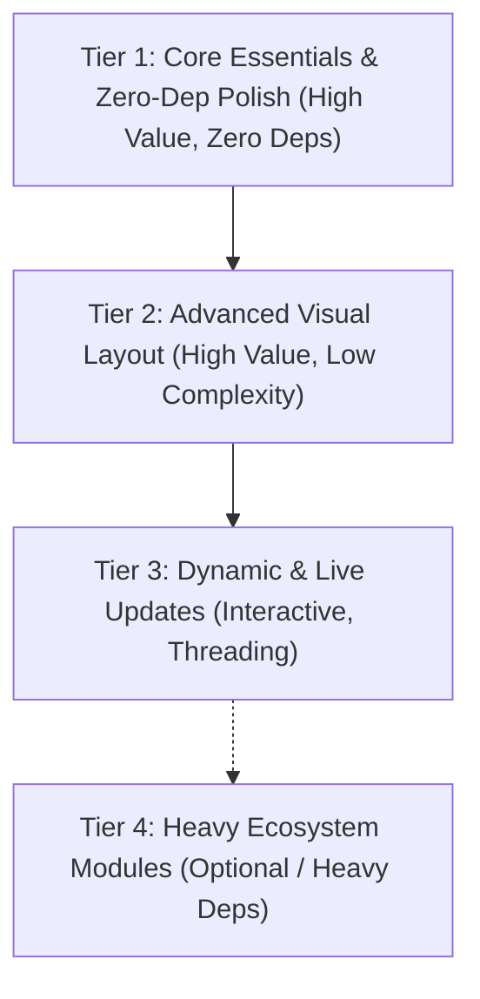

# C++ Rich Library Pragmatic Roadmap

This document structures the roadmap for **Rich C++** by **complexity vs. value tiers**, enabling modular development without forcing heavy third-party dependencies unless explicitly desired.

---

## Current Status Overview

| Tier | Focus | Dependencies | Status |
| :--- | :--- | :--- | :---: |
| **Tier 0** | Architectural Kernel & Basic Widgets | 0 (Pure C++20) | ✅ **Completed & Validated** |
| **Tier 1** | Core Polish & Text Foundations (Boxes, Wrapping, Terminal Width, NO_COLOR) | 0 (Pure C++20) | ✅ **Completed & Validated (16/16 Oracle)** |
| **Tier 2** | Advanced Visual Layout (Tree, Align, Constrain, Layout) | 0 (Pure C++20) | ✅ **Completed & Validated (16/16 Oracle)** |
| **Tier 3** | Dynamic & Live Displays (Progress Bars, Spinners) | 0 (`std::jthread` / VT escapes) | ✅ **Completed & Validated (20/20 Oracle)** |
| **Tier 4** | Heavy Ecosystem Modules (Markdown, Highlighting, Stacktrace) | Optional 3rd-party (`md4c`, `cpptrace`) | ⚠️ **Optional / Deferrable** |

---

## Tier 0: Architectural Kernel & Proof-of-Concept *(Completed)*
- [x] **Renderable Concept & AnyRenderable**: C++20 ADL customization points (`render_item`, `measure_item`) with value-semantic type erasure.
- [x] **Core Primitives**: `Segment`, `Style` (16 ANSI colors, bright variants, bold, dim, italic, underline, reverse, RGB), `Color`.
- [x] **Console**: `Console::print`, `Console::rule`, `Console::export_text`, record mode buffer, automatic Windows `CP_UTF8` and VT processing initialization.
- [x] **Containers & Decorators**:
  - `Panel` with centered title, custom borders, multiline support.
  - `Table` with multi-column grid, Unicode box drawing, column justification.
  - `Columns` with multi-row wrapping and independent left-aligned lines.
  - `Padding` with pipe operator (`|`) composition.
- [x] **Initial Oracle Validation**: Exact byte-level matches for basic Panel, Table, Rule, and Columns layouts.

---

## Tier 1: Core Essentials & Zero-Dep Polish *(Completed)*
*Goal: Make the library completely robust for standard CLI tool output with zero external dependencies.*

### 1.1 Terminal Dimensions & Stream Detection
- [x] **Auto Terminal Width**:
  - Windows: Query `GetConsoleScreenBufferInfo` for active window column count.
  - POSIX: Query `ioctl(STDOUT_FILENO, TIOCGWINSZ, &ws)`.
  - Fallback: Defaults to 80 columns when redirected or in fixed mode.
- [x] **NO_COLOR Standard**:
  - Respects `NO_COLOR` environment variable (https://no-color.org).

### 1.2 Text Wrapping & Formatting (`rich::text::Text`)
- [x] **Word Wrapping Engine**:
  - Soft-wrap text streams at whitespace boundaries to fit within console width.
  - Exact whitespace and trailing newline parity with Python Rich text wrapping.

### 1.3 Box Style Library (`rich::box`)
- [x] **Box Presets (`src/rich-cpp/core/box.h`)**:
  - `box::ROUNDED` (`╭─╮│╰─╯`)
  - `box::SQUARE` (`┌─┐│└─┘`)
  - `box::HEAVY` (`┏━┓┃┗━┛`)
  - `box::DOUBLE` (`╔═╗║╚═╝`)
  - `box::ASCII` (`+-+|+-+`)
- [x] **Configurable Borders**: Both `Panel` and `Table` accept arbitrary box styles via designated initializers.

### 1.4 Oracle Parity Validation
- [x] Automated byte-level validation for `box_double`, `box_heavy`, `box_ascii`, and `text_wrap` (all passing).

---

## Tier 2: Advanced Visual Layout *(Completed - Zero Dependencies)*
*Goal: Deliver full visual dashboard and structural composition capabilities.*

### 2.1 `Tree` Widget (`rich::tree::Tree`)
- [x] **Hierarchical Data Visualization (`src/rich-cpp/panel/Tree.h`)**:
  - Nested tree branches with guide glyphs (`├── `, `└── `, `│   `).
  - Arbitrary labels with inline markup parsing.
  - Verified bit-for-bit against Python Rich `Tree` (Oracle test `tree_basic`).

### 2.2 `Align` & `Constrain` Decorators
- [x] **`Align` (`src/rich-cpp/panel/Align.h`)**: Wrapper to horizontally center, left-align, or right-align any renderable within console width.
  - Syntax: `panel(...) | align(Justify::Center)`
  - Line normalization + padding parity with Python `Align` (Oracle tests `align_center`, `align_right`, `align_left`).
- [x] **`Constrain` (`src/rich-cpp/panel/Constrain.h`)**: Clamp maximum width of any nested renderable.
  - Syntax: `table | constrain(60)`
  - Verified bit-for-bit against Python `Constrain` (Oracle test `constrain_basic`).

### 2.3 `Layout` Engine (Flexible Grid Splits)
- [x] Split screen into sub-regions:
  - `layout.split_row(...)` (horizontal division).
  - `layout.split_column(...)` (vertical division).
  - Proportional sizing via `ratio` (e.g. 1:2 split).
  - Fixed-size constraints (`size = 10`).
- [x] **`Layout` (`src/rich-cpp/panel/Layout.h`)**: recursive region division via `split_row` / `split_column`, fixed `size` + proportional `ratio` distribution (Python `ratio_resolve` parity), named sub-layout lookup (`get("name")`). Verified bit-for-bit against Python Rich (Oracle tests `layout_row`, `layout_column`).

---

## Tier 3: Dynamic & Live Displays *(Completed - Self-Contained)*
*Goal: Support in-place terminal redraws, progress bars, and status spinners.*

### 3.1 Smooth Progress Bar (`rich::progress`)
- [x] **Block Progress Bar (`src/rich-cpp/core/ProgressBar.h`)**:
  - Fraction block characters: `█` (filled) and `░` (empty).
  - Percentage indicator with aligned padding.
- [x] **Multi-Column Progress Tracker (`src/rich-cpp/core/ProgressTracker.h`)**:
  - Half-cell bar rendering (`━`×N + optional `╸`) matching Python Rich's `ProgressBar` exactly.
  - Rolling-window speed estimation (30 s window, deque of `(timestamp, delta)` samples).
  - ETA estimator: `ceil(remaining / speed)` formatted as `H:MM:SS`; `-:--:--` when unknown.
  - Table.grid column-width algorithm for multi-task layout (bar preferred width 40, shrink-wrap).
  - Oracle tests: `progress_tracker` (frozen clock), `progress_speed` (advancing clock, speed 8.4 it/s, ETA `0:00:02`).
- [x] **Range Tracking Adapter (`src/rich-cpp/core/Track.h`)**:
  - `track(tracker, "desc")(range)` returns a `TrackRange` that ticks the task on each iteration.
  - Usage: `for (auto& x : track(tracker, "Processing")(items)) { ... }`
  - Verified: 100% / `0:00:00` on full loop; exception-safe mid-loop at 60%.

### 3.2 Live Display Engine (`rich::live`)
- [x] In-place screen redraw using VT cursor repositioning escapes (`\x1b[<N>F` move up, `\r\x1b[2K` erase per line).
- [x] Atomic screen flush via mutex to prevent output tearing.
- [x] Background refresh loop driven by `std::jthread`; deterministic teardown (join before state clear).
- [x] Non-TTY degradation: single plain final render, no control codes, no thread (matches Python behavior).
- [x] Transient mode: erases the live region on stop.
- [x] Oracle test: `live_static` (static render path, byte-exact).

### 3.3 Status Spinner (`rich::status`)
- [x] Indeterminate loading spinners using animated Braille frames (`⠋⠙⠹⠸⠼⠴⠦⠧⠇⠏`).
- [x] Background `std::jthread` rewrites the line in place every 80 ms (`\r\x1b[2K` + new frame).
- [x] Deterministic teardown: `stop()` joins the worker before clearing console pointer (fixes use-after-free crash when followed by a `Live`).
- [x] Static render path (frame 0) for oracle comparison: `status_static` test passes.

---

## ⚠️ Tier 4: Heavy Ecosystem Modules *(Optional / Deferrable)*
*Goal: Provide specialized document rendering or introspection only if strictly needed.*
*Note: Stop before this tier if zero-dependency and lightweight compilation are priorities.*

| Module | Python Rich Equivalent | Proposed C++ Strategy | Dependency Impact | Recommendation |
| :--- | :--- | :--- | :--- | :--- |
| **Markdown** | `rich.markdown` | Integrate `md4c` CommonMark parser | Lightweight C library | **Optional**: Integrate as separate CMake target `rich::markdown` |
| **Syntax Highlighting** | `rich.syntax` | Regex lexer or Tree-Sitter | Heavy grammar binaries | **Defer**: Provide pluggable `Highlighter` interface instead |
| **Tracebacks** | `rich.traceback` | `cpptrace` or C++23 `<stacktrace>` | Platform symbol resolution | **Nice-to-have**: Standalone CMake target `rich::traceback` |
| **SVG Export** | `Console.save_svg` | Pure C++ SVG string templating | **0 deps** | **Useful**: Web snapshots of terminal sessions |
| **Full Unicode Tables** | `rich.cells` | Generate static C++ table or `utf8proc` | Minimal table or 1 C dep | **Only if needed**: For CJK/emoji-heavy tools |

---

## Downstream Packaging & CI
- [x] Basic GitHub Actions CI workflow (`.github/workflows/ci.yml`).
- [x] Basic `vcpkg.json` manifest.
- [x] Matrix CI build across:
  - MSVC (Windows x64)
  - GCC 11+ (Ubuntu Linux x64)
  - Clang 13+ (macOS ARM64/x64)
- [x] CMake downstream export verification (`find_package(rich CONFIG REQUIRED)`).
